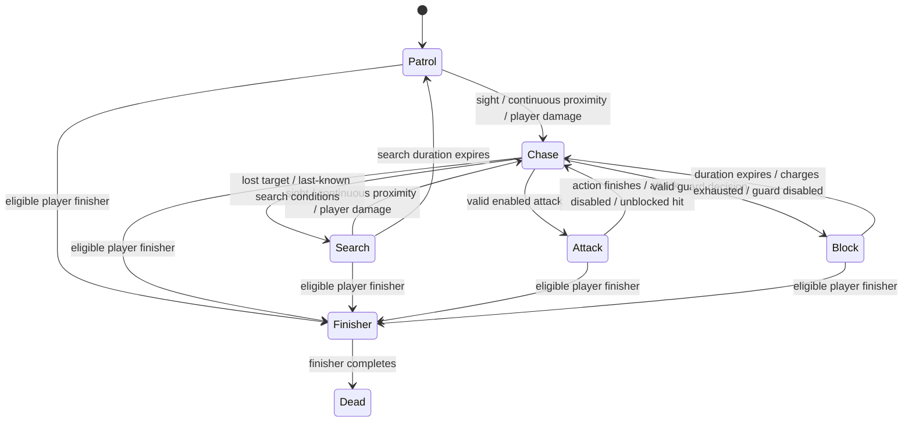

# Blueprint enemy: internal reference

Documented version: 12 November 2026, including intelligence scaling and the animation correction based on `BP_Enemy_punch`.

Research supplement added 13 November 2026: [Fachliche Einordnung und Quellen](#fachliche-einordnung-und-quellen-13-november-2026). The German [presentation plan](Fachvortrag/Folienlayout_und_Sprechtext.md) and [evidence dossier](Fachvortrag/EnemyAI_Hintergrund_und_Quellen.md) connect these functions to the assessment criteria. External literature motivates design choices; it does not validate this project's tuning or player experience.

Presentation revision V2 adds a [scoped comparison with the original BP_Enemy_punch](Fachvortrag/Alt_Neu_Vergleich.md). The original already includes perception, lost-sight handling and patrol support; the comparison distinguishes those existing foundations from the new combat/resources/progression scope and does not claim measured performance or player-experience superiority.

Presentation revision V3, [Enemy AI: Sensory Setup and Difficulty scaling](Fachvortrag/README.md), focuses on sensory conditions, designer control of responsiveness, external difficulty inputs and derived decision timing. It separates current capabilities from possible expansions and documents the coupling between stat levels and intelligence. This revision changes documentation only.

This document describes the implementation in `EnemyINProgress/BlueprintOnly`. Function names match the names in Unreal's **My Blueprint** panel. It covers every custom function, event entry point, construction graph and animation graph in the seven Blueprint assets. Standard inherited engine functions and individual library nodes are explained where they affect behavior; this is not a catalog of every Unreal node.

The descriptions were checked against the saved asset graph inventory in [GraphInventory.json](GraphInventory.json), the graph-authoring specification, and the animation and intelligence patches. Defaults below are the generated class defaults; individual placed actors and maps can override them.

## Contents

- [Architecture and ownership](#architecture-and-ownership)
- [Lifecycle and execution order](#lifecycle-and-execution-order)
- [States and transitions](#states-and-transitions)
- [BP_Enemy function reference](#bp_enemy-function-reference)
- [Health component](#ac_enemyhealth_bp)
- [Combat component](#ac_enemycombat_bp)
- [Animation Blueprint](#abp_enemy)
- [Player bridge](#bp_playerbridge)
- [Spawner](#bp_enemyspawner)
- [Test observer](#bp_testobserver)
- [Variables and defaults](#variables-and-defaults)
- [Worked examples](#worked-examples)
- [Integration, extension and debugging](#integration-extension-and-debugging)
- [Authoring and verification](#authoring-and-verification)

## Architecture and ownership

| Asset | Engine parent | Responsibility |
| --- | --- | --- |
| `BP_Enemy` | `Character` | Owns the state machine, sensing, movement requests, decisions, attack timers, blocking, difficulty, presentation, finishers and death. |
| `AC_EnemyHealth_BP` | `ActorComponent` | Stores health, applies already-adjusted damage, preserves health percentage when maximum health changes, and calculates health-based finisher eligibility. |
| `AC_EnemyCombat_BP` | `ActorComponent` | Sends point damage to a victim through Unreal's damage system. |
| `ABP_Enemy` | `AnimInstance` | Converts movement into locomotion poses and provides the montage slot used by actions. |
| `BP_PlayerBridge` | `Actor` | Receives finisher input and owns the temporary player movement-input lock from taser hits. |
| `BP_EnemySpawner` | `Actor` | Tracks room quotas, finds usable spawn points and applies progression values to spawned enemies. |
| `BP_TestObserver` | `Actor` | Provides an optional command-line smoke test in the test map. |

`BP_Enemy` contains `Health` and `Combat` components of the two Blueprint component classes above. Its inherited capsule, skeletal mesh and Character Movement component handle collision, animation and movement. `HealthWidget` displays health, `FinishWidget` displays the finisher prompt, and `TaserBeam` is a non-colliding cylinder used as a brief blue beam.

The enemy uses the standard `AIController` and navigation movement helpers. This implementation does not run a Behavior Tree, Blackboard, AI Perception component or EQS query. The decision structure is ordinary Blueprint function calls and integer states.

The generated runtime assets use standard engine parents and nodes. The existing plugin supplies editor authoring and verification tools, but the Blueprint enemy does not call those tools during gameplay. The original player's Blueprint has not been edited to add this enemy; `BP_PlayerBridge` provides the additional finisher input path.

## Lifecycle and execution order

### BP_Enemy EventGraph — BeginPlay

**Descriptor:** Initializes one spawned or placed enemy and connects it to the local player's shared input bridge.

Execution order:

1. Store the current actor location in `PatrolOrigin`.
2. Call `Health.Initialize`.
3. Call the enemy's `SetDifficultyLevels` with its four stored level variables.
4. Request a default AI controller.
5. Make the capsule block the Visibility trace channel.
6. Configure the taser cylinder: no collision, cylinder mesh and blue material.
7. Find an existing `BP_PlayerBridge`, or spawn one if none exists. Save its reference in `InputBridge`.
8. Call `UpdatePresentation`.

The spawner calls `SetDifficultyLevels` again after a successful spawn using the spawner's levels. The Blueprint spawner does this after spawning; it does not inject these values into a deferred-spawn construction phase.

### BP_Enemy EventGraph — Tick

**Descriptor:** Advances resources, behavior, finishers and presentation for each living enemy.

The configured actor tick interval is `0.05` seconds. Unreal provides the elapsed `DeltaSeconds`; timers subtract that elapsed time rather than assuming a fixed frame rate. If `State != 6`, Tick calls these functions in this order:

```text
UpdateResources(Delta)
  -> UpdateBrain(Delta)
  -> AdvanceFinisher(Delta)
  -> UpdatePresentation()
```

This ordering matters: recharge and decision timers advance before the brain checks them. `UpdateBrain` does no work in Finisher or Dead state. `AdvanceFinisher` only works in Finisher state. Dead enemies stop this whole update chain, although their configured lifespan still removes them later.

### BP_Enemy EventGraph — AnyDamage

**Descriptor:** Routes Unreal damage events into the enemy's block, health and reaction logic.

The event passes its damage amount to `ReceiveCombatDamage`. If `InstigatedBy` is a valid controller, it uses that controller's pawn as `Source`; otherwise it uses `DamageCauser`. A valid controller with no pawn does not receive a second fallback in this graph. Supplying a meaningful instigator or damage causer matters for player attribution and block direction.

### BP_Enemy EventGraph — EndPlay

**Descriptor:** Releases any player movement lock held by an interrupted finisher.

Calls `ReleaseFinishingPlayer` when the actor leaves play, including destruction during a finisher.

### UserConstructionScript

**Descriptor:** The standard construction graph has no custom enemy setup logic. Gameplay initialization is in BeginPlay.

## States and transitions

`State` is an integer rather than a Blueprint enum. Preserve this mapping when editing graphs.

| Value | Meaning | Main processing |
| --- | --- | --- |
| `0` | Patrol | `Think` → `PatrolOrSearch`; random reachable goals around `PatrolOrigin`. |
| `1` | Chase | `Think`; approach an aware target, select combat actions, or travel toward its last known location. |
| `2` | Search | `Think` → `PatrolOrSearch`; explore around `LastKnownLocation` until search expires. |
| `3` | Attack | `UpdateBrain`; count down impact and action timers. |
| `4` | Block | `UpdateBrain`; stop moving, face the target and hold guard. |
| `5` | Finisher | `AdvanceFinisher`; normal sensing and decisions are suspended. |
| `6` | Dead | Normal enemy Tick work stops; ragdoll and lifespan handle the corpse. |



Ordinary lethal damage can call `Die` from any normal combat state. The diagram shows the usual routes; the guards inside individual functions remain authoritative.

## BP_Enemy function reference

### SetState(NewState)

**Descriptor:** Changes behavior state and performs shared transition cleanup.

If `NewState` equals `State`, the function does nothing. Otherwise it stops `GuardMontage` with a `0.1` second blend-out when leaving Block, stores the new state, clears `HasGoal`, and sets `RepathTime` to zero. Entering Chase sets `DecisionTime = DecisionInterval`. Entering Search resets `SearchTime` to zero.

Use this function for transitions instead of writing `State` directly. Direct writes bypass guard cleanup, navigation invalidation and the new decision delay. This function does not itself validate the integer or enforce an allowed-transition table.

### SetDifficultyLevels(Damage, Block, HealthLevelInput, MovementSpeed)

**Descriptor:** Applies the four external progression integers and refreshes dependent health, shield capacity and intelligence.

Each input clamps to `0–10000` and is stored as `DamageLevel`, `BlockLevel`, `HealthLevel` or `MovementLevel`. The function remembers the old block capacity, calls `RefreshIntelligence`, then calls `Health.UpdateMaximum` with `Refill = false`.

```text
Maximum health = BaseHealth + HealthPerLevel * HealthLevel
MaximumBlockHits = clamp(BaseBlockHits + BlockHitsPerLevel * BlockLevel, 1, 10000)
```

If the shield is not recharging, remaining block hits change by the difference between the old and new capacities, clamped into the new capacity. This preserves already-spent hits instead of refilling the shield whenever levels change. If it is recharging, the eventual refill uses the new capacity.

Damage scaling is read at attack impact, and movement scaling is read during normal thinking; they are not applied by repeatedly multiplying a previously scaled stat. Health changes preserve the existing health fraction and do not resurrect a dead health component. The function does not directly refresh the widget or move the enemy; the normal update chain handles those changes.

### RefreshIntelligence()

**Descriptor:** Derives intelligence and bounded decision/navigation delays from the stored difficulty levels.

```text
IntelligenceLevel = (DamageLevel + BlockLevel + HealthLevel + MovementLevel) / 4
IntelligenceAlpha = clamp(IntelligenceLevel / max(0.01, IntelligenceLevelForMaximum), 0, 1)
DecisionInterval = 0.35 - 0.25 * IntelligenceAlpha
PathUpdateInterval = 0.40 - 0.25 * IntelligenceAlpha
```

The default `IntelligenceLevelForMaximum` is `10`. Average level zero produces decision/path intervals of `0.35/0.40` seconds. Average level ten or above produces `0.10/0.15` seconds. Existing `DecisionTime` and `RepathTime` are shortened to at most the new intervals, so increasing difficulty need not wait for an obsolete longer delay.

This function changes decision pacing, not montage play rates, attack windups, resource cooldowns or the proximity-detection duration. Call `SetDifficultyLevels`, or explicitly refresh intelligence, after changing its inputs at runtime.

### RefreshCombatChoices()

**Descriptor:** Calculates the heavy-attack and block probabilities for the next decision using intelligence, target movement and enemy health.

First, `HeavyDecisionChance` receives `clamp(HeavyChance, 0, 1)`. With a valid target, a good heavy opening means horizontal target speed is at most `75 cm/s` and distance is at most `0.8 * MeleeRange`. The desired heavy probability is `0.8` for that opening and zero otherwise. The final chance interpolates from the configured base chance toward that desired value by `IntelligenceAlpha`.

```text
Wounded = 1 - clamp(CurrentHealth / max(1, MaximumHealth), 0, 1)
BlockDecisionChance = clamp(BlockChance + IntelligenceAlpha * Wounded * 0.4, 0, 0.85)
```

These are preferences, not permission checks. `TryAttack` and `TryBlock` still enforce state, enable toggles, range, charges and cooldowns. If only heavy melee is enabled, the selection logic can choose heavy regardless of its calculated preference. The current logic does not inspect whether the player is winding up a strike or deliberately time a parry.

### AttackEnabled(Index) → Enabled

**Descriptor:** Pure query that maps an attack index to its enable toggle.

`0` reads `EnableLight`, `1` reads `EnableHeavy`, and `2` reads `EnableTaser`. Other indices return false. It does not check range, cooldown, charges, target validity or state. Block is controlled separately by `EnableBlock`.

### SetAttackEnabled(Index, Enabled)

**Descriptor:** Changes an attack toggle and safely cancels that attack if it is currently pending.

For indices `0–2`, writes the corresponding enable variable. If the enemy is in Attack, the active `AttackIndex` matches, and `Enabled` is false, it clears `PendingImpact`, clears `ActionTime`, stops the animation montage and enters Chase.

Use this function for runtime attack changes. Setting a toggle directly still affects impact permission checks, but does not perform the same immediate state and montage cancellation. To disable guard, set `EnableBlock`; `UpdateBrain` ends the current guard on its next update.

### ClearLineTo(Actor) → Clear

**Descriptor:** Performs the common visibility/cover trace used by sensing, attacks and finishers.

Resets `ClearSight` to false. With a valid actor, traces on `TraceTypeQuery1` from the enemy's location plus `(0,0,64)` to the actor's location plus `(0,0,45)`. It ignores this enemy and uses a non-complex trace. The result is clear when nothing blocks the trace or the first blocking hit belongs to the requested actor.

This is a line-of-sight test, not a navigation-path query. The name does not imply that a walkable route exists. `ClearSight` is a shared scratch result; it is overwritten by each call. Callers use the returned `Clear` output immediately rather than treating the scratch value as persistent awareness.

### NotifyPlayerDamage(Source)

**Descriptor:** Makes damage attributed to a player-controlled Character alert the enemy.

Casts `Source` to Character and requires `IsPlayerControlled` plus a state below Finisher. On acceptance, sets `Target`, copies the source location into `LastKnownLocation`, and resets `UnseenTime`. States below Attack enter Chase; existing attacks and blocks are left running.

This path bypasses the sight cone and proximity waiting period. Non-player damage can still reduce health through `ReceiveCombatDamage`, but does not establish a player target here. There is no separate distance limit on this alert.

### UpdateSenses(Delta)

**Descriptor:** Samples player visibility and continuous nearby presence, then updates awareness and the last known location.

Fetches player Character index `0` each update and resets `Visible` and `NearPlayer`. A valid player must have `bCanBeDamaged` true for the sensory sample. A common `ClearLineTo` result is combined with distance and a forward-cone dot product for sight. Nearby presence uses distance and the same line trace, without requiring the forward cone.

`ProximityTime` accumulates only while `NearPlayer` remains true; leaving that condition resets it to zero. If the player is visible, or the proximity time reaches `ProximitySeconds`, the enemy sets `Target`, refreshes `LastKnownLocation`, resets `UnseenTime`, and moves Patrol or Search into Chase. Otherwise `UnseenTime` increases.

Default sight is `1800 cm` with a `65°` half-angle. Default nearby detection is `250 cm` held continuously for `2.5 s`. Walls can prevent both. Sensing continues during Attack and Block, but not Finisher or Dead because of `UpdateBrain`'s state guard. This graph does not implement a separate dead-player health interface or team/faction selection.

### MoveToPoint(Goal, Acceptance)

**Descriptor:** Throttles navigation requests and records the current movement goal.

Only runs when `RepathTime <= 0`. It resets that timer to `PathUpdateInterval`, stores `MoveGoal`, and sets `HasGoal = true`. If distance exceeds `Acceptance`, it calls `SimpleMoveToLocation` on the controller; otherwise it stops the controller and movement component immediately.

`Acceptance` is checked by this function before requesting movement. It is not passed as a custom acceptance-radius parameter to `SimpleMoveToLocation`. The graph does not obtain a success/failure result from that helper, so `HasGoal` records the requested goal rather than proving a valid path was found. Patrol/search later examine distance and controller move status.

### PatrolOrSearch(Delta)

**Descriptor:** Chooses random reachable goals and handles pauses for both wandering and searching.

In Search, increments `SearchTime`; reaching `SearchDuration` clears `Target` and enters Patrol. If an existing goal is within `100 cm`, or the AI controller reports Idle, it clears `HasGoal` and starts `PauseTime = PatrolPause`.

Without a goal, it reduces `PauseTime`. When the pause expires, it requests a random reachable navigation point around `PatrolOrigin` with `PatrolRadius`, or around `LastKnownLocation` with `SearchRadius`. A successful sample goes to `MoveToPoint` with acceptance `60`; failure sets a one-second retry pause.

Defaults: patrol radius `900 cm`, search radius `500 cm`, patrol pause `1.5 s`, search duration `10 s`. Search uses the same pause setting as patrol. There is no persistent list of already-searched points.

### Think(Delta)

**Descriptor:** Chooses what a non-attacking, non-blocking enemy should do next.

Outside Chase, delegates to `PatrolOrSearch`. In Chase, an invalid target changes state to Search. With a valid target, current visibility or completed continuous proximity permits combat decisions. When `DecisionTime <= 0`, it refreshes combat probabilities and tries the following:

1. If within melee range, optionally `TryBlock` using `BlockDecisionChance`.
2. If still in Chase, select light or heavy melee using enabled attacks and `HeavyDecisionChance`, then call `TryAttack`.
3. If still in Chase, try the taser. `TryAttack` enforces its allowed distance and resources.
4. Reset `DecisionTime` to `DecisionInterval`.

While still in Chase, move toward `PursuitGoal`, with acceptance `max(30, MeleeRange * 0.65)`. The goal starts at `LastKnownLocation`. Only while `Visible` is true, add the target's velocity capped to magnitude `450`, multiplied by `0.45 * IntelligenceAlpha`. This leads observed movement at higher intelligence.

Without current awareness, move toward `LastKnownLocation` with acceptance `70`. Enter Search when both `UnseenTime >= SightMemory` and distance to that point is below `150`, or when `UnseenTime > SightMemory + 8`. The default memory value is `2 s`. This branch does not keep navigating to the hidden player's live position.

### UpdateBrain(Delta)

**Descriptor:** Dispatches sensing, action timing and normal thinking according to the current state.

Only processes states below Finisher. It calls `UpdateSenses` first, then:

| Current state | Work |
| --- | --- |
| Attack | Subtract `Delta` from `ActionTime` and `ImpactTime`; call `ResolveAttack` once when a pending impact becomes due; return to Chase when the action timer expires. |
| Block | Stop movement, face a valid target, reduce `ActionTime`; return to Chase when guard is disabled, hits run out or duration expires. Set the post-block delay to `DecisionInterval * (5 / 3.5)`. |
| Other normal states | Calculate movement speed, set Character Movement's `MaxWalkSpeed`, then call `Think`. |

Movement speed is `clamp(BaseStateSpeed * (1 + MovementPerLevel * MovementLevel), 1, MaximumSpeed)`. `BaseStateSpeed` is `ChaseSpeed` in Chase and `PatrolSpeed` otherwise. The graph temporarily uses `AnimationRate` to hold this base movement speed on the thinking branch; `TryAttack` overwrites it with the actual montage rate before a melee action. Do not interpret that variable as a valid attack play rate in every state.

### TryAttack(Index) → Started

**Descriptor:** Validates and starts one attack, schedules its impact, and selects its presentation.

Resets `AttackAccepted` to false. Requires Chase, a valid target and `AttackEnabled(Index)`. It then requires a clear line and a valid attack distance. Melee requires distance at most `MeleeRange`. Taser requires distance between `MinimumTaserDistance` and `TaserRange`, available shots and no recharge. Its minimum distance is normally `TaserMinimumRange`; it becomes zero when both melee attacks are disabled.

On acceptance, stops movement, faces the target, stores `AttackIndex`, sets the light/heavy `AnimationRate`, schedules timers, marks `PendingImpact`, sets `AttackAccepted` and enters Attack.

```text
Melee ImpactTime = MeleeWindup / max(0.01, AnimationRate)
Melee initial ActionTime = (MeleeWindup + MeleeRecovery) / max(0.01, AnimationRate)
Taser ImpactTime = TaserWindup
Taser ActionTime = TaserWindup + TaserShotInterval
```

For melee, chooses one of the three existing punch montages, caches it in `ActiveMeleeMontage` and plays that exact asset. The installed animation correction extends `ActionTime` to at least `ActiveMeleeMontage.PlayLength / AnimationRate + 0.1`, preventing another action from cutting the clip short. Light and heavy share the pool and differ by speed and damage. The current taser branch uses its beam and timing; it does not play a dedicated taser montage.

`Started` reports that the action began, not that damage was delivered. The autonomous `Think` path checks `DecisionTime` before calling this function; direct external calls to `TryAttack` do not themselves enforce that decision delay. Actual damage remains subject to `ResolveAttack`'s later checks.

### ResolveAttack()

**Descriptor:** Resolves a scheduled attack at its impact time and sends any resulting damage through the combat component.

Clears `PendingImpact` immediately, then requires a valid target and that the active attack is still enabled. For taser, consumes one shot; reaching zero starts `TaserRecharge = TaserCooldown`. This consumption happens before the new cover/range check, so a shot can be spent even if cover prevents damage.

Chooses the base damage for `AttackIndex`, performs a fresh `ClearLineTo`, and checks impact distance. Melee additionally requires a forward dot product of at least `0.25`. Taser uses its maximum range at impact; its minimum distance is a start-condition check.

```text
Delivered damage = selected base damage * (1 + DamagePerLevel * DamageLevel)
```

On a valid hit, calls `Combat.DealPointDamage`. For taser, a valid cast to the project's player class, a valid `InputBridge`, and `Blocking == false` additionally allow `InputBridge.ApplyStun(TaserStunSeconds)`. The target's existing point-damage logic handles its own damage/block response.

The taser presentation positions the cylinder midway between enemy and target, rotates its Z axis along the shot direction, scales its length to their separation and shows it for `0.15 s`. This is a target-directed visual placeholder, not a projectile or a beam clipped to a blocking surface. Cover prevention comes from the damage trace.

### TryBlock() → Started

**Descriptor:** Starts a timed guard if the enemy has an enabled, charged shield and is in Chase.

Resets `BlockAccepted` to false. Requires Chase, `EnableBlock`, positive `BlockHits`, and `BlockRecharge <= 0`. On success, stops movement, enters Block, sets `ActionTime = BlockDuration`, and marks acceptance.

Plays `BlockAnimation` through `PlaySlotAnimationAsDynamicMontage` in `DefaultSlot`, with `0.1 s` blend-in/out and a long loop count. The dynamic montage is cached in `GuardMontage`; leaving Block stops it through `SetState`. The current asset is an idle placeholder rather than a completed guard pose. Starting guard does not consume a hit; only successfully blocked incoming damage spends shield charges.

### UpdateResources(Delta)

**Descriptor:** Advances recharge, decision, path-update and beam-lifetime timers.

For a positive `TaserRecharge` or `BlockRecharge`, subtracts elapsed time and clamps to zero. On expiry, refills taser shots to exactly two or block hits to `MaximumBlockHits`. It also reduces `DecisionTime`, `RepathTime` and `BeamTime` toward zero, and hides the beam once its timer is zero.

It does not count down `ActionTime`, `ImpactTime`, `SearchTime`, `PauseTime`, `ProximityTime` or `FinisherTime`; their owning functions handle them. A partly spent taser magazine does not refill just because time passes: the six-second recharge begins after the second shot is consumed. A partly spent shield similarly waits until exhaustion to start recharge.

### ReceiveCombatDamage(Amount, Source)

**Descriptor:** Owns incoming-damage processing: attribution, directional blocking, health reduction, interruption and death.

Requires `State < 5` and a positive amount. Calls `NotifyPlayerDamage`, saves the incoming amount and clears `HitWasBlocked`. Guard applies only in Block, with guard enabled, positive charges and a valid source. The source direction must lie within `BlockHalfAngle` of the enemy's forward direction, tested with a dot product against the horizontal source direction.

An accepted block multiplies damage by `0.25`, spends one `BlockHits` charge and sets `HitWasBlocked`. Exhausting charges starts `BlockRecharge = BlockCooldown` and enters Chase. It then calls `Health.ProcessDamage` with the adjusted amount.

If health is dead, calls `Die`. Otherwise an unblocked hit clears `PendingImpact`, exits Attack if needed, plays `HitReaction`, and sets `DecisionTime = DecisionInterval * (4 / 3.5)`. A successfully blocked hit does not run this hit-reaction interruption branch. Finally, refreshes presentation.

The default guard half-angle is `100°`; tune that value if the desired shield arc should be narrower. Missing/invalid source attribution prevents this directional guard check from accepting the hit. Finisher and Dead states reject this function's normal damage processing.

### UpdatePresentation()

**Descriptor:** Synchronizes the health display and state-aware finisher eligibility.

Gets the health widget, casts to `WBP_Healthbar` and calls `SetFillLevel(CurrentHealth / max(1, MaximumHealth))` only when both widget and its `Material` reference are valid. The material guard avoids accessing it before widget initialization completes.

Writes `Health.CanFinish` when health is positive, health is at or below `MaximumHealth * FinisherThreshold`, and `State < 5`. Shows or hides `FinishWidget` from that result. The component calculates a health-based result too; this function adds the character-state restriction and is the regularly refreshed presentation authority.

### BeginFinisher(PlayerActor)

**Descriptor:** Starts the paired enemy/player finisher once eligibility, range and line of sight pass.

Requires `Health.CanFinish`, a valid player Character, distance at most `350 cm`, and a clear line. On acceptance, stops enemy movement, enters Finisher, cancels the pending attack, stores `FinishingPlayer` and saves the player's previous movement mode. It disables movement on both characters and sets the project player's `FinisherActive` flag when the cast succeeds.

Faces the enemy toward the player, plays `EnemyFinisher` on the enemy and `PlayerFinisher` on the player. `FinisherTime` is the player's montage-play return duration, with a minimum of `0.1 s`.

This function does not move both actors into an exact synchronized alignment or use motion warping. It depends on the regularly updated `CanFinish` value; external systems should call this public entry point rather than setting Finisher state themselves.

### AdvanceFinisher(Delta)

**Descriptor:** Counts down a running finisher and kills the enemy when the finisher duration ends.

Only works in state `5`. Subtracts elapsed time from `FinisherTime`. At zero, calls `Health.ProcessDamage` for `MaximumHealth`, then calls `Die`. Normal incoming damage and combat decisions do not drive the finisher's completion.

### ReleaseFinishingPlayer()

**Descriptor:** Restores the player after a completed or interrupted enemy finisher.

With a valid `FinishingPlayer`, clears the project's `FinisherActive` flag when possible, restores the stored movement mode and clears the reference. The custom movement submode is restored as zero; there is no separate saved custom-mode value. Called by both `Die` and EndPlay. Repeated calls become harmless once the reference is cleared.

### Die()

**Descriptor:** Performs the enemy's one-time transition to a non-interactive ragdoll corpse and triggers the existing sanity interaction.

If not already Dead: releases the finisher player, stops movement, enters Dead, cancels pending impact, sets `bCanBeDamaged = false`, disables movement and stops the montage. Disables capsule collision, gives the skeletal mesh the `Ragdoll` profile and enables mesh physics. Hides the health widget, finisher prompt and taser beam.

Finds the existing `Sanity` actor and calls `SanityActivation` if it exists. Sets the corpse lifespan to eight seconds. The function does not itself force component health to zero; ordinary callers already reach it through lethal damage or finisher damage. It does not continuously ask the spawner for a replacement.

## AC_EnemyHealth_BP

The component has no custom EventGraph event processing. `BP_Enemy` calls its functions explicitly. Its health state is distinct from the character's behavior `State`.

### Initialize()

**Descriptor:** Fills `CurrentHealth` from `MaximumHealth` and clears `Dead` for initial setup.

Called by enemy BeginPlay before difficulty is applied. It does not independently refresh `CanFinish` or any widget; the character's initial `UpdatePresentation` follows later.

### UpdateMaximum(NewMaximum, Refill)

**Descriptor:** Changes maximum health while optionally retaining the current health percentage.

Caches `CurrentHealth / max(1, MaximumHealth)` in `RatioCache`, then sets the maximum to at least one. If not Dead, fills to the new maximum when `Refill` is true, otherwise sets current health to the new maximum times the cached ratio. A dead component's current health is not refilled. It does not call death, presentation or AI functions.

### ProcessDamage(Amount)

**Descriptor:** Subtracts a positive, already-adjusted damage amount and recalculates death/finisher flags.

If not Dead and amount is positive, sets current health to `clamp(CurrentHealth - Amount, 0, MaximumHealth)`. Then sets `Dead` from health being zero or below, and `CanFinish` from living health being at or below the threshold fraction. Default `FinisherThreshold` is `0.3`.

This component does not apply block reduction, identify attackers, cancel actions or ragdoll the actor. Those are character responsibilities. Calling it directly bypasses `ReceiveCombatDamage`'s normal interactions, so use the character damage path for ordinary gameplay damage.

## AC_EnemyCombat_BP

The component has no custom EventGraph processing.

### DealPointDamage(Victim, Amount)

**Descriptor:** Builds a point-damage event attributed to this enemy and delivers it to a valid victim.

Gets its owning actor, calculates a horizontal direction from owner to victim, and builds a blocking `HitResult` using the victim actor, location/impact point and root primitive component. Calls Unreal `ApplyPointDamage` with the owner as `DamageCauser` and the owner's instigator controller as `EventInstigator`.

It does not trace, recheck attack range, apply difficulty or decide shield reduction. `ResolveAttack` already handles the enemy-side checks and scaling; the victim handles its own incoming damage response. This uses a synthetic hit at the victim's actor location rather than an animation-driven fist collision or specific bone hit.

## ABP_Enemy

This asset's graphs were copied from the animation setup used by `BP_Enemy_punch`, while its update logic uses a generic pawn/Character owner. It remains an engine `AnimInstance` Blueprint. These are animation graphs and event logic, not additional AI decision functions.

| Graph / entry point | Descriptor and behavior |
| --- | --- |
| EventGraph → `BlueprintUpdateAnimation` | Gets a valid pawn owner and calculates horizontal velocity magnitude into `Speed`. Copies that value into `Velocity`, derives `bIsInAir` from Character Movement being Falling (`MovementMode == 3`), and sets `IsMoving` from speed being greater than zero. |
| `AnimGraph` | Produces the final mesh pose using the reference cached base/combat poses, blends and montage slot setup. This is where locomotion and slot playback meet. |
| `LocoStateMachine` | Routes between grounded locomotion, falling and landing. The entry state is `Idle/Walk/Run`. |
| `Idle/Walk/Run` | Evaluates `BS_EnemyWalkRun` using the scalar variable named `Velocity` on its X axis. Despite its name, this variable is a speed value, not a Vector. |
| `FP_Falling` | Plays `Falling_Idle` while the character is falling. |
| `FP_JumpEnd` | Plays `Falling_To_Landing` after the airborne state. |
| `AnimationTransitionGraph_2` | The falling-to-landing rule uses `NOT bIsInAir`. |
| `Transition` — grounded to falling | Reads `bIsInAir` to allow entry to `FP_Falling`. |
| `Transition` — landing to grounded | Uses `NOT bIsInAir` to return to `Idle/Walk/Run`. The graph shares the generic name `Transition` with the other transition graph. |

The copied state machine currently uses those airborne booleans; do not assume there is an additional custom landing-duration decision in the AI. `DefaultSlot` supports the action montages and dynamic block montage. The current block clip is still `AS_BlockPlaceholder`.

The mesh is the nurse `Ch11_nonPBR`; the reference correction sets relative location `(0,0,-90)`, yaw `260°`, scale one, and capsule half-height `85`. Animation tick policy matches the reference's `AlwaysTickPose`. Preserve `Velocity` bindings when editing the animation graph: renaming that variable without updating the blend-space/property bindings can break locomotion even if `Speed` continues updating.

## BP_PlayerBridge

One bridge is found or created by the enemies and shared through their `InputBridge` references. It targets local player index zero. It has no custom construction logic.

### ApplyStun(Seconds)

**Descriptor:** Applies or extends a temporary player movement-input lock without stacking duplicate locks owned by this bridge.

Requires a valid `PlayerController` and a positive duration. If not already locked, calls `SetIgnoreMoveInput(true)` once and sets `StunLocked`. Sets `StunRemaining = max(existing remaining time, Seconds)` and immediately stops the player movement component.

Repeated taser hits refresh the remaining duration to at least the requested time; they do not add all durations together. The lock prevents movement input, not all input: it does not separately disable looking, attacking or finisher input.

### EventGraph entries

| Entry | Descriptor |
| --- | --- |
| BeginPlay | Stores player Character and controller index zero, then calls `EnableInput` for that controller. |
| Tick | Reduces `StunRemaining` toward zero. If its owned lock is active and the timer expires, calls `SetIgnoreMoveInput(false)` once and clears `StunLocked`. |
| EndPlay | Releases its owned movement-input lock if still active. |
| `IA_Finisher` → Started | Traces `350 cm` forward from the player camera on the visibility trace channel, ignoring the player. If the hit actor casts to `BP_Enemy`, calls that enemy's `BeginFinisher(Player)`. |
| `UserConstructionScript` | Standard construction graph; no custom setup. |

The input action and its existing mapping must still be available to the player. The bridge does not replace or edit the old player's hard-coded finisher casts; it supplies a path for the new enemy alongside existing input handling.

## BP_EnemySpawner

The spawner's actor tick interval is `0.5 s`. Its construction graph has no custom setup; EventGraph Tick calls `SpawnPending`. It does not create its own navigation bounds or generate the procedural map.

### SetDifficultyLevels(Damage, Block, HealthLevelInput, MovementSpeed, UpdateExisting)

**Descriptor:** Stores the progression levels used for future spawns and optionally reapplies them to already tracked enemies.

Clamps each level to `0–10000`. When `UpdateExisting` is true, iterates valid references in `SpawnedEnemies` and calls their `SetDifficultyLevels` functions. Future successful spawns always receive the current stored levels. The update loop checks validity, not a separate living-state condition; the enemy's health component prevents dead-health resurrection during scaling.

### ProcessRoom(Room)

**Descriptor:** Tracks one room's lifetime spawn quota and attempts one safe spawn for that room during this call.

Looks for `Room` in `Rooms`. A new entry gets a matching zero in `RoomCounts` and a random integer quota between `MinimumPerRoom` and `MaximumPerRoom` in `RoomQuotas`. These arrays use matching indices.

Attempts a spawn only when the room count is below quota, `AliveCount < MaximumAlive`, and successful spawns this update are below `SpawnBudget`. The attempt:

1. Samples a random reachable navigation point around the room actor within `SpawnRadius`.
2. Raises the candidate by `101 cm` to place the character capsule above the sampled ground point.
3. Requires a successful navigation sample and the configured minimum distance from the player.
4. Rejects a blocking capsule overlap using radius `42` and half-height `96`, checking the configured WorldStatic/Pawn object types and ignoring the spawner.
5. Rejects another `BP_Enemy` within `MinimumEnemyDistance` using a sphere overlap.
6. Spawns `BP_Enemy` with `DontSpawnIfColliding`.
7. On a valid spawned actor, applies difficulty, records its reference, increments the room count, `AliveCount` and `SpawnsThisTick`.

Only a successful spawn consumes room quota. Failed samples/overlaps are retried on later spawner updates. The overlap shape is intentionally more conservative than the corrected enemy capsule; it is not automatically read from the enemy's current capsule defaults. The separation filter is this Blueprint enemy class, rather than every enemy type in the project.

`SpawnBudget` counts successful spawns, not every failed point sample. Each processed room gets at most one attempt per `ProcessRoom` call. Room quota counts lifetime successful spawns; death does not decrement it.

### SpawnPending()

**Descriptor:** Waits for map readiness, counts living tracked enemies and processes either the standalone origin or eligible procedural rooms.

Gets player Character index zero. `Ready` starts true when `SpawnAroundSpawner` is true or `WaitForMap` is false. Otherwise it looks for `Map_Generator` and reads `MapComplete`. A valid player and readiness are required to populate.

Resets `AliveCount` and `SpawnsThisTick`, then counts valid tracked enemies whose health component is not Dead. In standalone mode, calls `ProcessRoom` with the spawner itself as the room/origin. Otherwise, gets all `Master_Room` actors, skips actors whose object name contains `Spawn_Room`, and requires room origins to meet `MinimumPlayerDistance` before processing them. Candidate points receive their own distance check too.

`WaitForMap = false` bypasses the generator flag; it does not make dungeon mode work without rooms or navigation. Successful navigation sampling remains necessary. `MaximumAlive` limits concurrent living population, while room quotas limit lifetime wave size. Destroyed references remain in the tracking array but are skipped during valid-reference checks.

### Spawner defaults

| Setting | Class default | Meaning |
| --- | --- | --- |
| `SpawnAroundSpawner` | false | Use the spawner as a single room/origin when true. |
| `WaitForMap` | true | Wait for procedural completion unless standalone mode is enabled. |
| `MinimumPerRoom` / `MaximumPerRoom` | 1 / 2 | Random lifetime quota for each tracked room. |
| `MaximumAlive` | 20 | Concurrent living-enemy ceiling. |
| `SpawnRadius` | 650 cm | Navigation sample radius around the chosen origin. |
| `MinimumPlayerDistance` | 900 cm | Candidate and procedural room-origin exclusion distance. |
| `MinimumEnemyDistance` | 180 cm | Separation from other Blueprint enemies. |
| `SpawnBudget` | 3 | Maximum successful spawns per spawner update. |

The supplied `L_EnemyTest_BP` overrides the wave counts to three, radius to `1200`, minimum player distance to `1000`, standalone mode on and map waiting off. Class defaults and map-instance overrides are separate values.

## BP_TestObserver

This asset has no custom callable functions and no custom construction logic. Its behavior is entirely in EventGraph.

| Entry | Descriptor |
| --- | --- |
| BeginPlay | Reads the command line and enables the observer only when it contains `BlueprintOnlySmoke`. |
| Tick | While enabled and not yet reported, accumulates `Elapsed`. At twelve seconds, counts `BP_Enemy` actors, those with valid controllers, and those moving horizontally faster than `5 cm/s`; prints `BLUEPRINT_ONLY_SMOKE enemies=… controllers=… moving=…`, marks `Reported`, and calls `QuitGame`. |
| `UserConstructionScript` | No custom setup. |

During normal editor Play without the flag, the observer does nothing. Its actor count is a class count; it is not the same definition as the spawner's living-health population count. The test confirms activity at a sample time, not that every enemy is moving or that every gameplay system passed a full playthrough.

## Variables and defaults

### Identity, awareness and movement state

| Variables | Meaning |
| --- | --- |
| `State` | Integer behavior state described above. |
| `Player` | Player index-zero Character fetched by sensing; not proof of current awareness. |
| `Target` | Character currently being pursued/attacked. |
| `Visible`, `NearPlayer` | Current sensory sample results. |
| `ClearSight` | Scratch result from the most recent line trace. |
| `LastKnownLocation` | Remembered player position from awareness or attributed player damage. |
| `PursuitGoal` | Last known point plus optional visible-motion prediction. |
| `PatrolOrigin` | Spawn/BeginPlay location used as the patrol center. |
| `MoveGoal`, `HasGoal` | Requested navigation destination and whether the behavior considers it active. |
| `InputBridge` | Shared bridge reference used for player stun. |
| `FinishingPlayer`, `PreviousPlayerMode` | Finisher cleanup ownership and movement restoration data. |

### Timer ownership

| Timer | Advanced by | Purpose |
| --- | --- | --- |
| `DecisionTime` | `UpdateResources` | Earliest next autonomous combat decision. |
| `RepathTime` | `UpdateResources` | Earliest next movement request. |
| `TaserRecharge` | `UpdateResources` | Time until the empty magazine refills to two shots. |
| `BlockRecharge` | `UpdateResources` | Time until the exhausted shield refills. |
| `BeamTime` | `UpdateResources` | Remaining beam visibility time. |
| `ActionTime` | `UpdateBrain` | Remaining attack recovery or guard duration. |
| `ImpactTime` | `UpdateBrain`, during Attack | Time until a scheduled attack resolves. |
| `ProximityTime` | `UpdateSenses` | Continuous nearby-player dwell time. |
| `UnseenTime` | `UpdateSenses` | Time since awareness last refreshed. |
| `SearchTime` | `PatrolOrSearch` | Elapsed search duration. |
| `PauseTime` | `PatrolOrSearch` | Remaining wait before another random goal. |
| `FinisherTime` | `AdvanceFinisher` | Remaining paired finisher duration. |
| Bridge `StunRemaining` | Bridge Tick | Remaining movement-input stun. |

Timers use seconds. `SearchTime`, `ProximityTime` and `UnseenTime` accumulate upward; most action/resource timers count downward. A zero decision timer does not authorize attacks during Block, Attack, Finisher or Dead; state guards still apply.

### Main tuning defaults

| Group | Defaults |
| --- | --- |
| Base health | `BaseHealth = 100`, `HealthPerLevel = 20`, component `FinisherThreshold = 0.3`. |
| Difficulty | All four levels `0`; `DamagePerLevel = 0.15`, `MovementPerLevel = 0.08`. |
| Intelligence | `IntelligenceLevelForMaximum = 10`; derived alpha `0–1`; decision `0.35–0.10 s`, path interval `0.40–0.15 s`. |
| Movement | `PatrolSpeed = 160`, `ChaseSpeed = 360`, `MaximumSpeed = 750` cm/s. |
| Patrol/search | `PatrolRadius = 900`, `SearchRadius = 500` cm; `PatrolPause = 1.5`, `SearchDuration = 10` seconds. |
| Sensing | `SightRadius = 1800`, `ProximityRadius = 250` cm; `SightHalfAngle = 65°`, `ProximitySeconds = 2.5`, `SightMemory = 2` seconds. |
| Enable toggles | `EnableLight`, `EnableHeavy`, `EnableTaser`, `EnableBlock` all true. |
| Melee | `LightDamage = 12`, `HeavyDamage = 25`, `MeleeRange = 160` cm; `LightRate = 1.35`, `HeavyRate = 0.75`, `HeavyChance = 0.35`; `MeleeWindup = 0.5`, `MeleeRecovery = 0.8` seconds before play-rate adjustment. |
| Taser | `TaserDamage = 8`; `TaserRange = 1100`, `TaserMinimumRange = 230` cm; `TaserWindup = 0.45`, `TaserShotInterval = 1`, `TaserCooldown = 6`, `TaserStunSeconds = 1.25`; two shots. |
| Block | `BaseBlockHits = 3`, `BlockHitsPerLevel = 1`, `BlockDuration = 1.2 s`, `BlockCooldown = 6 s`, `BlockChance = 0.25`, `BlockHalfAngle = 100°`; accepted blocks pass 25% of incoming damage. |

Distances are Unreal centimeters. Most actor-to-actor range checks use full vector distance. Cone, melee-facing and block-direction checks normalize horizontally; locomotion animation uses horizontal speed.

### Combat/presentation scratch variables

| Variables | Meaning |
| --- | --- |
| `AttackIndex` | Active/chosen attack: 0 light, 1 heavy, 2 taser. |
| `AttackAccepted`, `BlockAccepted` | Latest start attempt result; also supplied through function outputs. |
| `PendingImpact` | Ensures the active attack resolves at most once. |
| `AnimationRate` | Attack rate during melee; reused for base speed in the normal-thinking branch. |
| `MinimumTaserDistance` | Effective taser lower bound after checking the enabled melee configuration. |
| `TaserShots`, `BlockHits` | Current expendable charges. |
| `MaximumBlockHits`, `OldBlockCapacity` | Current shield capacity and cached prior capacity for live scaling. |
| `HeavyDecisionChance`, `BlockDecisionChance` | Context-adjusted probabilities for the current decision. |
| `IncomingDamage`, `HitWasBlocked` | Scratch adjusted damage amount and guard outcome. |
| `ShotDamage` | Scratch base impact damage; also reused as the random navigation sampling radius in patrol/search. It is not always the last damage actually delivered. |
| `BeamStart`, `BeamEnd` | Visual endpoints for the latest taser shot. |
| `MeleeMontages`, `ActiveMeleeMontage` | Three-punch asset pool and the exact cached selected clip. |
| `BlockAnimation`, `GuardMontage` | Placeholder sequence and its running dynamic slot montage. |
| `HitReaction`, `EnemyFinisher`, `PlayerFinisher` | Existing montage references used for reactions and paired finishers. |

## Worked examples

### A player approaches from behind

The forward-cone test fails, so `Visible` is false. If the player stays within `250 cm` with a clear trace, `ProximityTime` accumulates. At `2.5 s`, awareness updates the last known location and enters Chase. Moving away or breaking the nearby line-of-sight condition resets that continuous timer. Player-attributed damage can alert the enemy immediately instead.

### A light punch at base difficulty

`Think` waits for its decision delay and chooses light. `TryAttack(0)` starts only in Chase with a valid, clear, in-range target. With rate `1.35`, the nominal impact occurs after `0.5 / 1.35 ≈ 0.370 s`. At impact, `ResolveAttack` checks cover, range and facing again, then sends `12` point damage. The montage-duration correction can hold the action longer than the nominal recovery. Returning to Chase starts a new `0.35 s` decision wait at intelligence zero.

### Three shielded hits

An enemy begins with three shield hits. Three accepted frontal hits of `20` each become `5` health damage each, consuming the shield. The third starts its six-second recharge and leaves Block. Remaining health is `85` if it started at `100`. Guard cannot restart while exhausted. At recharge completion, hits refill to the current `MaximumBlockHits`.

### Progression values 2, 2, 3, 4

Health maximum becomes `160`; default shield capacity becomes `5`. Damage becomes `1.3` times base. Base chase speed becomes `360 * 1.32 = 475.2 cm/s`. Average intelligence is `2.75`, alpha `0.275`, decision interval `0.28125 s`, and path update interval `0.33125 s`. An enemy at 85% health remains at 85%, so its current health becomes `136`.

### Two taser shots

The first accepted taser attack schedules a shot after `0.45 s`. Resolving it reduces shots from two to one with no magazine cooldown. The action timer is `1.45 s` from the start, followed by the next Chase decision delay. The second resolution reduces shots to zero and starts the six-second cooldown. A target moving behind cover during windup can avoid damage while the fired shot is still consumed. At cooldown expiry, both shots return.

### A fixed arena wave

In standalone mode, the spawner treats itself as one room. With minimum/maximum quota both three, each successful update consumes one of those three lifetime slots. Once all three have spawned, their deaths reduce the living count but do not reset the consumed quota. The spawner therefore does not endlessly replace them.

## Integration, extension and debugging

### Normal entry points for other systems

| Intent | Use |
| --- | --- |
| Damage this enemy | Unreal damage events with a meaningful instigator/causer, routed by AnyDamage. |
| Directly supply already-attributed incoming damage | `BP_Enemy.ReceiveCombatDamage`, preserving the guard/health/reaction path. |
| Update progress for one enemy | `BP_Enemy.SetDifficultyLevels`. |
| Update a population and future spawns | Spawner `SetDifficultyLevels`, with `UpdateExisting` as appropriate. |
| Enable/disable an attack during play | `SetAttackEnabled` for attack indices 0–2. |
| Enable/disable guard | Set `EnableBlock`; the next brain update ends an active disabled guard. |
| Request a player finisher | `BeginFinisher`; allow it to validate eligibility, distance and line of sight. |
| Change movement state internally | `SetState`, preserving transition side effects. |

Directly calling `ProcessDamage`, writing `State`, editing a timer or forcing `Die` can skip normal gameplay interactions. Those operations are useful during controlled debugging but are not equivalent to the normal entry points.

### Symptom guide

| Symptom | Inspect first |
| --- | --- |
| Enemy stands still | Valid AI controller, navigation coverage, `State`, `HasGoal`, `MoveGoal`, `RepathTime`; action states intentionally stop movement. |
| Enemy never sees the player | Player index zero, `bCanBeDamaged`, sight range/cone, Visibility collision, `ClearLineTo` result. |
| Proximity never triggers | `NearPlayer`, uninterrupted `ProximityTime`, walls and range. |
| Enemy knows a position after being hit | `NotifyPlayerDamage` deliberately records an attributed player's current position. |
| No attack starts | Chase state, `DecisionTime`, enable toggles, line trace, distance, taser charges/minimum range. |
| Attack starts but misses | `PendingImpact`, impact-time range/facing/cover, later disabling or unblocked-hit cancellation. |
| Taser fires only twice | Expected magazine behavior; inspect `TaserRecharge` before changing logic. |
| Guard pose looks idle | Current placeholder asset; protection is determined by state/hits/direction, independently of the pose. |
| Punch is cut off | Cached `ActiveMeleeMontage`, `ActionTime` duration patch, compatible montage slot. |
| Locomotion is wrong | Mesh/AnimClass, `Velocity` binding in ABP, movement speed, reference transform and state machine. |
| Health bar initially fails | Widget and dynamic `Material` readiness; keep the `UpdatePresentation` validity guards. |
| Finisher prompt is absent | Health fraction, `FinisherThreshold`, state below five, presentation update and widget visibility. |
| Player stays movement-locked | Bridge `StunLocked`/timer and finisher `FinishingPlayer`; these are separate locking mechanisms. |
| Spawner produces nothing | Player, `MapComplete`/mode, navigation, room quota, minimum distances, overlap clearance and maximum-alive limit. |
| Both enemy versions spawn in the dungeon | Disable the original plugin's automatic dungeon spawner when testing the Blueprint population. |

### Current implementation boundaries

This is a local-player implementation centered on player index zero; multiplayer replication and authority handling are not implemented or tested. It has no squad coordination, hearing, faction logic, cover selection, explicit dodge/strafe behavior, player-attack prediction or learned behavior. Intelligence currently changes delays, pursuit lead and context-weighted attack/guard probabilities.

The player's existing `Blocking` and `FinisherActive` fields, point-damage handling, widgets, `Sanity`, input action, procedural generator and room classes remain integration dependencies. There is no dedicated taser projectile/montage or finished block animation. The spawner uses current project room names/types and fixed clearance dimensions. Its quotas do not implement continuous respawning or save-game persistence.

## Authoring and verification

The Python helpers and the plugin editor methods assemble or inspect normal Blueprint graphs. They are development utilities, not gameplay functions and not required to execute each enemy update.

| Tool/report | Descriptor |
| --- | --- |
| `Authoring/generate_blueprints.py` | Declares the original standard-node graphs, variables, components and defaults; emits `blueprints.json`. |
| `Authoring/build.py` | Builds the asset set in a fresh destination, refusing existing assets, then applies the reference animation correction. |
| `Authoring/fix_animations.py` | Applies the reference rig/AnimGraph setup and full-montage timing correction. |
| `Authoring/update_intelligence.py` | Replaces the named intelligence-related enemy functions and adds new variables while preserving components, animation graphs and existing tuning. |
| `Authoring/setup_map.py` | Creates/audits the Blueprint test map and its Blueprint spawner/observer configuration. |
| `Authoring/verify.py` | Runs Blueprint compile/parent/gameplay checks and writes `Verification.txt`. |
| `Authoring/verify_animation_poses.py` | Evaluates and compares animation poses against the punch reference. |
| `Authoring/document_inventory.py` | Reads the seven saved assets and writes the graph-name coverage inventory used for this document. |
| `Verification.txt` | Current 55 Blueprint compile/parent/gameplay checks, including intelligence and actual alert-to-attack timing. |
| `AnimationPoseVerification.txt` | Current 27 animation/setup checks against the reference. |
| `IntelligenceBuildReport.txt` | Confirms the intelligence-patched enemy compiled with zero errors and warnings. |

Back up assets before regeneration. The initial generator does not merge manual graph edits, and later patch helpers replace their named target functions. The actual saved Blueprint can contain corrections beyond the initial generator, notably the cloned animation graph and cached montage-duration logic described here. Keep both the authoring source and relevant post-build patches in mind when rebuilding.

No gameplay assets were changed to create this document. The read-only inventory completed successfully; the editor commandlet still reports the project's existing missing-sword compile errors in the unrelated legacy `BP_Enemy_Base`.

## Fachliche Einordnung und Quellen (13 November 2026)

Die folgenden Bezüge ergänzen die technische Funktionsbeschreibung. Parameter und Testergebnisse bleiben Projektdaten. Die Literatur liefert weder einen Beweis für deren optimale Wahl noch für bereits erreichte Persona-Passung.

| Funktionen / System | Fachlicher Bezug | Projektspezifische Analyse |
| --- | --- | --- |
| `UpdateSenses`, `ClearLineTo`, `NotifyPlayerDamage` | Martels öffentliche GDC-Sessionbeschreibung betont konfigurierbare, glaubwürdige Wahrnehmung [Q3]. | Sichtkegel, Sichtlinie und kontinuierliche Nähe haben unterschiedliche Aufgaben. 65° und 2,5 s sind zu testende Projektwerte. |
| `Think`, `PatrolOrSearch`, `SetState` | Die archivierten Halo-Vortragsnotizen thematisieren verständliches und interaktives Gegnerverhalten [Q2]. | LastKnownLocation begrenzt die Verfolgung nach Sichtverlust. Ob die Suche vom Spieler erkannt wird, ist noch zu testen. |
| `TryAttack`, `ResolveAttack`, `TryBlock` | MDA trennt Mechaniken, entstehende Dynamiken und angestrebtes Erleben [Q1]. | Zwei Taser-Schüsse und begrenzte Schildtreffer sollen Timingentscheidungen erzeugen. Diese Wirkung ist eine Hypothese. |
| `ABP_Enemy`, `ActiveMeleeMontage` | Epics Montage-Dokumentation beschreibt Blueprint-Steuerung und Slots [Q5]. | Die vollständige Montage-Dauer wird in der Aktion berücksichtigt; die Posenprüfung ist davon getrennte technische Evidenz. |
| `RefreshIntelligence`, `RefreshCombatChoices` | Die Bezeichnung Intelligenz steht hier für eine selbst definierte Heuristik. | Der Mittelwert der Progressionslevel ist kein IQ, kein Lernen und keine automatische Leistungsanpassung. Kürzere Entscheidungszeiten können ebenso unfair wirken; getrennt testen. |
| `ProcessRoom`, `MoveToPoint` | Epics Navigation-Übersicht erklärt NavMesh-basierte Wegfindung [Q6]. | MapComplete allein bestätigt keine erfolgreiche Navigation. Erreichbare Zufallspunkte und Clearance bleiben nötig. |
| Zielgruppe und Playtest | Ryan et al. untersuchen Zusammenhänge von Kompetenz/Autonomie und Spielerleben [Q4]. | Die tatsächliche Persona ist noch einzutragen. Zielgruppeneignung wird durch eine technische Testsuite nicht gemessen. |

### Verwendete Fachquellen

- **Q1:** Hunicke, R., LeBlanc, M. & Zubek, R. (2004). [MDA: A Formal Approach to Game Design and Game Research](https://www.cs.northwestern.edu/~hunicke/MDA.pdf). Originalbeitrag, insbesondere PDF-S. 2–3.
- **Q2:** Butcher, C. & Griesemer, J. (2002). [Creating the Illusion of Intelligence: archivierte Originalvortragsnotizen, Seite 25](https://halo.bungie.org/misc/gdc.2002.haloai/talk.html?page=25). GDC 2002. Praxisbeispiel, kein experimenteller Wirksamkeitsnachweis.
- **Q3:** Martel, E. (2017). [Can You See Me Now? Building Robust AI Sensory Systems](https://www.gdcvault.com/play/1026497/Can-You-See-Me-Now). GDC AI Summit. Grundlage ist die öffentliche Sessionbeschreibung; keine vollständige Videoauswertung.
- **Q4:** Ryan, R. M., Rigby, C. S. & Przybylski, A. (2006). [The Motivational Pull of Video Games: A Self-Determination Theory Approach](https://selfdeterminationtheory.org/SDT/documents/2006_RyanRigbyPrzybylski_MandE.pdf). Motivation and Emotion, 30(4), 347–363. DOI: 10.1007/s11031-006-9051-8.
- **Q5:** Epic Games (o. J.). [Animation Montage, Unreal Engine 5.5](https://dev.epicgames.com/documentation/en-us/unreal-engine/animation-montage-in-unreal-engine?application_version=5.5).
- **Q6:** Epic Games (o. J.). [Navigation System, Unreal Engine 5.5](https://dev.epicgames.com/documentation/en-us/unreal-engine/navigation-system-in-unreal-engine?application_version=5.5).

Alle Links wurden am 13.11.2026 recherchiert. Vollständige Quellenkritik, Claims, Datenbasis und Vortragsauswahl stehen im Begleitdossier. Die technischen Funktionsbeschreibungen oben bleiben der Implementierungsnachweis; externe Quellen ersetzen diesen nicht.
